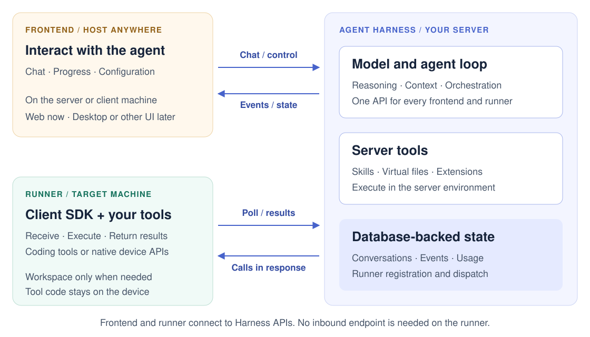
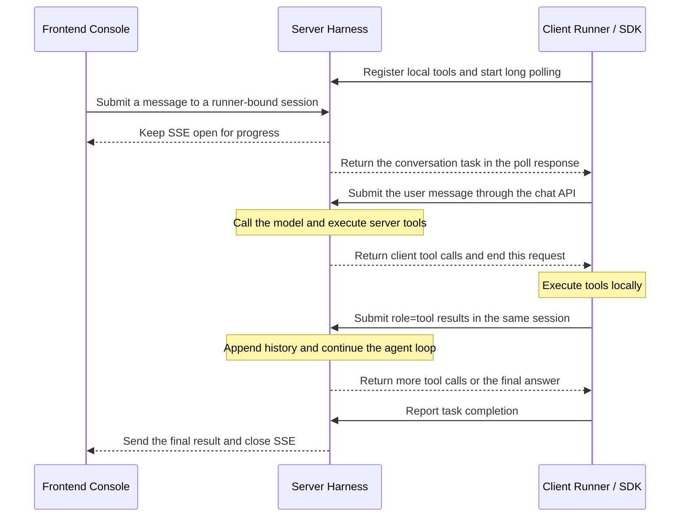

# JAgentHarness

**English** | [简体中文](README.zh-CN.md)

**Run the agent on your server. Execute tools where your work lives.**

JAgentHarness separates the agent harness, tool runner, and user interface. The server manages the model and conversation. A lightweight runner carries native tools and executes them on the target machine. The frontend talks to the server and can run on either machine.



## Three parts, one protocol

| Part | Responsibility | Implementation |
| --- | --- | --- |
| **Agent Harness** | Model calls, agent loop, context, database state, and server tools such as skills and virtual files | Java libraries with a [server example](examples/server-demo/README.md) |
| **Runner** | Scenario-specific native tools, execution permissions, and result delivery | [Client SDK](sdk/java/README.md) with a ready-to-run [coding distribution](examples/coding-runner/README.md) |
| **Frontend** | Conversations, progress, project selection, and configuration through server APIs | [Web Console](console/README.md), hosted on the server or client machine |

The runner includes its tool implementations. It advertises their schemas to the server, receives work over outbound HTTP long polling, and returns results through the conversation API. The frontend connects to the server, regardless of where it is hosted. The runner needs no inbound port. The Java SDK includes the runner runtime: provide your own `ToolDefinition` implementations for a new scenario. Only file-based tools need a workspace.

### Conversation flow

For a conversation bound to a runner, long polling delivers the conversation task. Tool calls and results then travel through ordinary chat requests in the same session, while the frontend receives one continuous event stream.



The tool-call exchange repeats as needed. The runner keeps polling during local execution to receive cancellation. Applications that initiate their own conversations can use `AgentClient.run()` directly, without runner dispatch.

## Why separate the harness from execution?

A robot controller, a phone app, a desktop application, and a Linux workspace each have their own runtime and native APIs. Tools must execute in that environment; model integration, context management, and persistent conversations can remain on a server.

Build the tools in the language that fits the device. Reuse the server's agent through a simple HTTP/JSON protocol. A web, desktop, or other frontend can use the same server APIs without taking ownership of local execution.

**Available today:** a Java server, a lightweight Java client SDK, a coding runner with built-in tools, and a web Console. Other languages can implement native runners without MCP. Robot, phone, desktop automation adapters, and a JavaScript SDK are not included.

## Features

- **Built for servers:** model integration, streaming, context compaction, and tool orchestration.
- **Database-backed state:** conversations, events, usage, and runner dispatch through JDBC.
- **Virtual files and skills:** server-managed prompts, skills, and supporting files with global and project scopes.
- **Lightweight execution:** native tools run in a client process without Spring, JDBC, or model SDKs.
- **Independent interface:** one set of server APIs for the current web Console and future desktop or other clients.

## Try it locally

Install **JDK 8+**, **Maven 3.6.3+**, and **Node.js 22.12+**. An OpenAI-compatible model endpoint is required; SQLite is included.

```sh
git clone https://github.com/differentialmanifold/jagent-harness.git
cd jagent-harness
cp .env.example .env.local
```

Set the model in `.env.local`:

```dotenv
JAGENT_MODEL=your-model-name
JAGENT_OPENAI_BASE_URL=https://your-provider.example/v1
JAGENT_OPENAI_API_KEY=your-api-key
```

Start all three parts:

```sh
node scripts/dev.mjs
```

Open **http://127.0.0.1:5175**, add a project, select **coding-local**, browse or enter a workspace on that terminal. Then ask:

> Read the README in this workspace and summarize the project.

The server drives the conversation while the runner reads the local file. All seven coding tools are available by default. Select which tools a project can use in **Configuration → Built-in tools → Client tools**; selected tools run with **Full access**, without approval prompts. One runner can serve multiple project directories. **Ctrl+C** stops the demo.

See [Quick start](QUICK_START.md) for independent startup, manual commands, remote machines, and Windows/macOS shortcuts.

## Integrate it

- [Server integration](jagent-harness-sdk/README.md): deploy and extend the harness through Maven libraries.
- [Coding runner](examples/coding-runner/README.md): run built-in tools on a target machine; [中文指南](examples/coding-runner/README.zh-CN.md).
- [Web Console](console/README.md): host the same frontend beside the server or on a client machine.
- [Java client SDK](sdk/java/README.md): register native tools with `AgentRunner`, or start conversations with `AgentClient`.
- [HTTP/JSON protocol](protocol/README.md): implement another runner or frontend.

This source tree targets `1.2.1`. Run `mvn install` before building a separate Maven consumer against local changes. The current host supports a single server instance and application-level authentication; platform permissions remain the runner's responsibility.

The source layout follows these roles: `jagent-harness-sdk/` contains the server libraries, `sdk/java/` contains the reusable client and runner runtime, `examples/` contains the server host and coding tool host, `console/` contains the frontend, and `protocol/` contains the language-independent contract and its tests.

## Development

```sh
mvn clean install
npm ci --prefix protocol
npm test --prefix protocol
npm ci --prefix console
npm test --prefix console
npm run build --prefix console
```

The Maven reactor contains the shared API, Java client SDK, coding runner, server libraries, and server example. The frontend builds independently into `console/dist/`. See [Releasing](RELEASING.md) for publication.

[MIT License](LICENSE).
