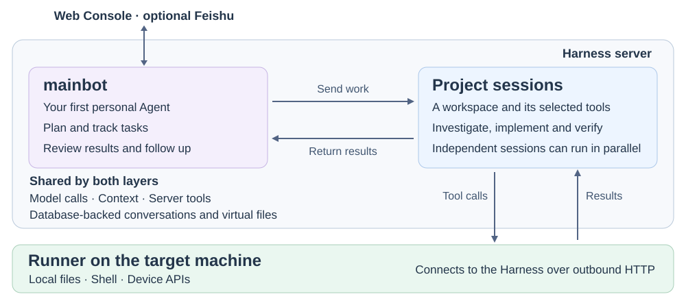
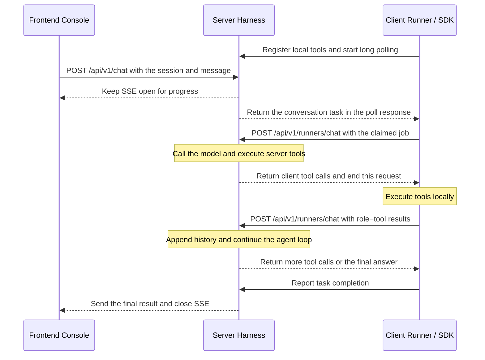

# JAgentHarness

**English** | [简体中文](README.zh-CN.md) · [Quick start](QUICK_START.md) · [Documentation](docs/README.md)

JAgentHarness gives each user **mainbot**, a personal Agent that remembers previous work and can see a goal through across conversations. Tell it what you want in the web Console or through Feishu. When a task needs files or commands, mainbot creates or reuses a Project, reviews the result and reports back in your chat.

## Architecture

| Part | What it does |
| --- | --- |
| **mainbot** | Keeps memory across chats. For a longer goal, it tracks steps and dependencies, checks progress, and uses Project results to decide what to do next. |
| **Project** | Gives the work a workspace, tools and sessions. mainbot can use separate sessions to investigate, implement and verify. Open **mainbot → Projects** to inspect the commands and results yourself. You can also create a Project and work in it directly. |
| **Runner** | Brings tools to the machine that owns the files or device. The Coding Runner reads files, edits code and runs shell commands there. It connects outbound to the Harness, which handles model calls and stores conversations and virtual files. |

Project results and scheduled checks bring mainbot back to a task while the Harness and Runner are running. It can also delegate across machines. For example, mainbot on a Linux Runner can ask an Agent bound to a Mac Runner to run an Xcode build, then use the build output to continue the original task. Each Agent works through its own Projects.

## Try mainbot

1. In the source checkout, copy `.env.example` to `.env.local` and enter your model connection. [Prerequisites and model settings](QUICK_START.md#install-and-start)
2. Run `node scripts/start.mjs local`. The local launcher opens the Console at **Agents → mainbot → Chat**.
3. Send a request you can verify:

   > Make a release checklist in a new workspace. Write two items to CHECKLIST.md, “Run tests” and “Write release notes”. Mark “Run tests” complete, read the file back, and tell me its path and what is still open.

Look for the path and the remaining item in **Chat**. Open **Projects** within mainbot to see the file operations. Then ask in the same chat, “Mark the release notes complete and check the file again.” mainbot can return to that workspace. For a multi-step example, see the [personal Agent guide](docs/guides/agents.md).

On a headless Linux host, use the per-user CLI from a service account. SQLite works out of the box; the same server package can connect to PostgreSQL. [Linux installation](QUICK_START.md#linux-servers-and-existing-services) · [Database settings](QUICK_START.md#choose-a-database)

## Other ways to use mainbot

- **Ask about your installation.** The Coding Runner automatically downloads the running Harness’s source. mainbot can inspect the server and Console code through a local Project, including on an offline network. It can also manage supported settings, such as adding a model or installing a Skill. [Configuration](docs/guides/configuration.md#ask-mainbot-to-configure-jagentharness)
- **Keep the files on another machine.** Host the Harness and Console together and run a lightweight Runner on your laptop or server. A second browser can pair with the same personal workspace. [Remote deployment and browser pairing](docs/guides/access.md)
- **Choose another interface.** Connect Feishu for messages and progress updates, or let another assistant use the Agent API. [Feishu](docs/guides/feishu.md) · [External Agent access](docs/guides/external-agents.md)

Direct Project chat and the Runner protocol

[Server libraries](jagent-harness-sdk/README.md) · [Node.js Runner](sdk/node/README.md) · [HTTP protocol](protocol/README.md) · [Contributing](CONTRIBUTING.md) · [MIT License](LICENSE)
