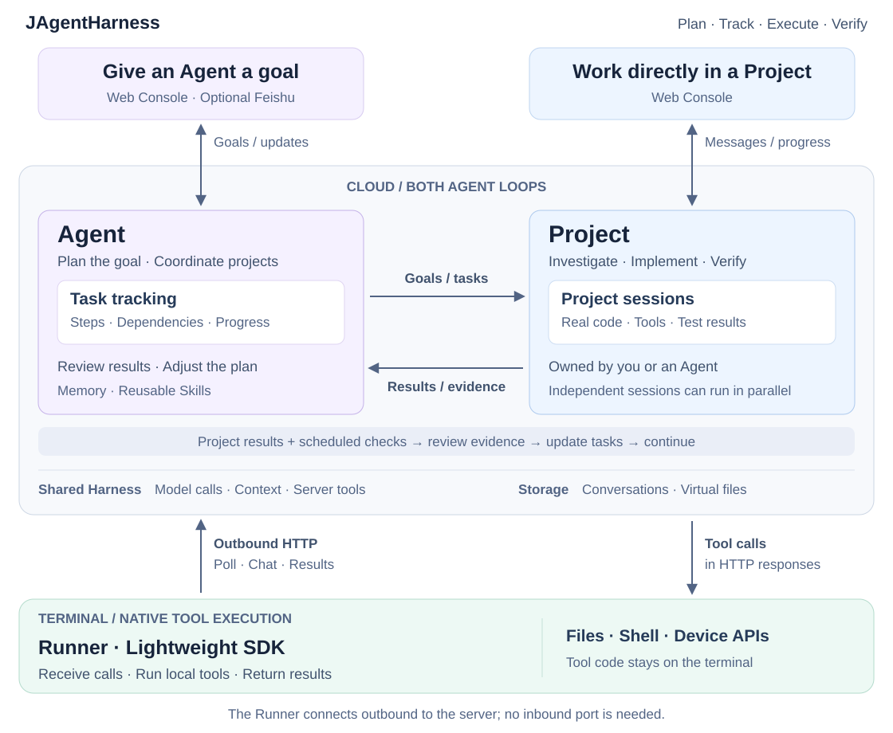
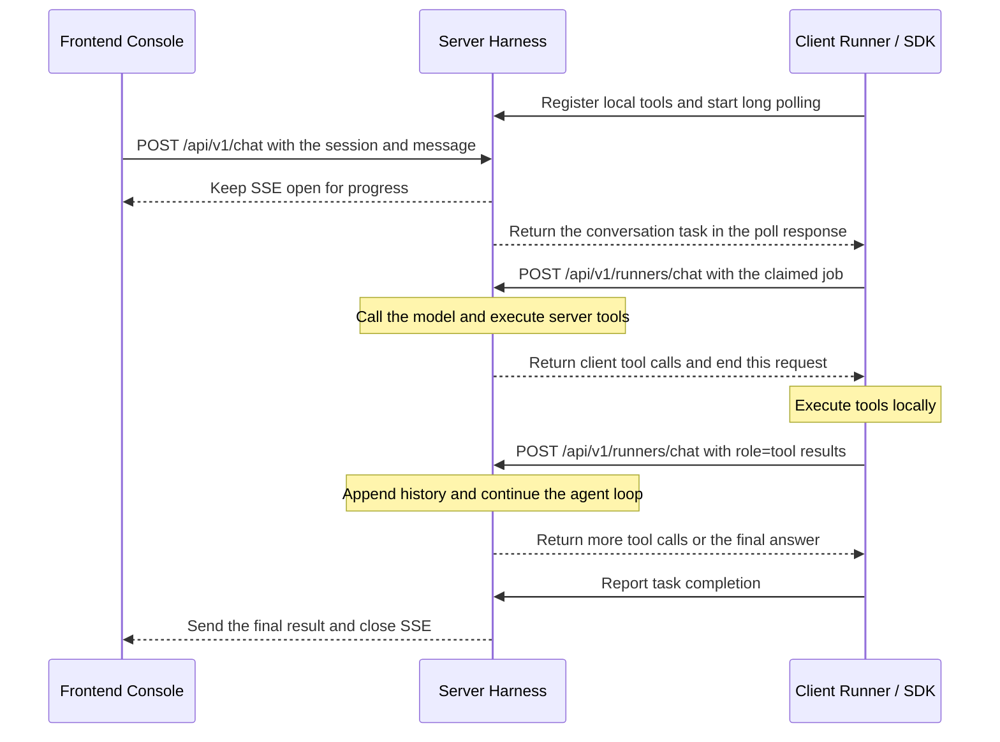

# JAgentHarness

**English** | [简体中文](README.zh-CN.md)

**Give an Agent a goal. Execute the work where your tools live.**

Work directly in a Project, or give a persistent Agent a goal to plan, track and follow through. JAgentHarness runs both layers on the server, while a lightweight Runner executes native tools where your files and applications live.

Business skills can activate their declared MCP tools on demand and retain them for the session. See the [MCP tool loading guide](docs/skill-mcp-loading.md).

## Architecture



- **Agent plans and tracks; Project carries out the work.** The Agent breaks a goal into tasks, tracks dependencies and progress, and uses Project sessions to investigate, implement and verify. Project results and scheduled checks bring it back to review evidence and adjust the plan. Users can also work directly in Projects.
- **Agent loops in the cloud; native tools on the terminal.** Agent and Project share the server Harness. Project sessions use a lightweight Runner to execute tools in the target environment and return results, so that environment needs no model SDK or server framework.

The shared Harness provides model calls, context management and server tools, backed by unified conversation and virtual file storage.

Try the [hands-on Agent guide](examples/personal-agents/README.md) to follow a goal through planning, execution and verification.

## Three parts, one protocol

| Part | Responsibility | Implementation |
| --- | --- | --- |
| **Agent Harness** | Personal Agents and project sessions; shared model calls, context, database state, and server tools | Java libraries with a [server example](examples/server-demo/README.md) |
| **Runner** | Scenario-specific native tools, execution permissions, and result delivery | [Client SDK](sdk/java/README.md) with a ready-to-run [coding distribution](examples/coding-runner/README.md) |
| **Frontend** | Agent and project chats, tasks, knowledge, and configuration through server APIs | [Web Console](console/README.md), hosted on the server or client machine |

The Runner ships with its tools and connects over outbound HTTP long polling; no inbound port is needed. Implement `ToolDefinition` to add a new scenario. Frontends use the server APIs wherever they are hosted. Projects using only server tools can run without a Runner.

<details>
<summary>Runner conversation flow</summary>

For a conversation bound to a runner, long polling delivers the conversation task. Tool calls and results then travel through ordinary chat requests in the same session, while the frontend receives one continuous event stream.



The tool-call exchange repeats as needed. The runner keeps polling during local execution to receive cancellation. Applications that initiate their own conversations can use `AgentClient.run()` directly, without runner dispatch.

</details>

## Try it locally

Install **JDK 8+**, **Maven 3.6.3+**, and **Node.js 22.12+**. An OpenAI-compatible model endpoint is required; SQLite is included.

```sh
git clone https://github.com/differentialmanifold/jagent-harness.git
cd jagent-harness
cp .env.example .env.local
```

Set the model in `.env.local`:

```dotenv
JAGENT_MODEL=your-model-name
JAGENT_OPENAI_BASE_URL=https://your-provider.example/v1
JAGENT_OPENAI_API_KEY=your-api-key
```

Start all three parts:

```sh
node scripts/dev.mjs
```

Open **http://127.0.0.1:5175** and choose an entry point:

- **Let an Agent work:** open **Agents → New Agent**, enter a name and select **coding-local**. Send a goal in its Chat; it can create its own project and workspace. Follow the [short Agent example](examples/personal-agents/README.md) for a ready-to-use request and what to look for.
- **Work in your own project:** add a project, select **coding-local**, then browse or enter a workspace on that terminal. Ask:

> Read the README in this workspace and summarize the project.

The server drives the conversation while the runner reads the local file. All seven coding tools are available by default. Select which tools a project can use in **Projects → Configuration → Tools → Client tools**; selected tools run with **Full access**, without approval prompts. One runner can serve multiple project directories. **Ctrl+C** stops the demo.

See [Quick start](QUICK_START.md) for independent startup, manual commands, remote machines, and Windows/macOS shortcuts.

## Use it from another Agent

Install the [JAgent skill](skills/jagent/SKILL.md) in your external Agent's skill directory, including its `scripts/` and `references/` folders. Configure `JAGENT_SERVER_URL` and, when required, `JAGENT_CLIENT_TOKEN`. The bundled Node.js client has no npm dependencies or MCP setup.

The external Agent finds a suitable Personal Agent or creates one on a connected Runner, sends it a goal, and follows progress and results in the same conversation. No Agent needs to be created manually beforehand. JAgent handles planning, task tracking and project execution; the same conversation is visible in the Console. See the [API and SDK reference](skills/jagent/references/api.md).

## Integrate it

- [Server integration](jagent-harness-sdk/README.md): deploy and extend the harness through Maven libraries.
- [Coding runner](examples/coding-runner/README.md): run built-in tools on a target machine; [中文指南](examples/coding-runner/README.zh-CN.md).
- [Web Console](console/README.md): host the same frontend beside the server or on a client machine.
- [Java client SDK](sdk/java/README.md): register native tools with `AgentRunner`, or start conversations with `AgentClient`.
- [HTTP/JSON protocol](protocol/README.md): implement another runner or frontend.

This source tree targets `2.2.0`. Run `mvn install` before building a separate Maven consumer against local changes. The current host supports a single server instance and application-level authentication; platform permissions remain the runner's responsibility.

The source layout follows these roles: `jagent-harness-sdk/` contains the server libraries, `sdk/java/` contains the reusable client and runner runtime, `examples/` contains the server host and coding tool host, `console/` contains the frontend, and `protocol/` contains the language-independent contract and its tests.

## Development

```sh
mvn clean install
npm ci --prefix protocol
npm test --prefix protocol
node --test skills/tests/*.test.mjs
npm ci --prefix console
npm test --prefix console
npm run build --prefix console
```

The Maven reactor contains the shared API, Java client SDK, coding runner, server libraries, and server example. The frontend builds independently into `console/dist/`. See [Releasing](RELEASING.md) for publication.

[MIT License](LICENSE).
