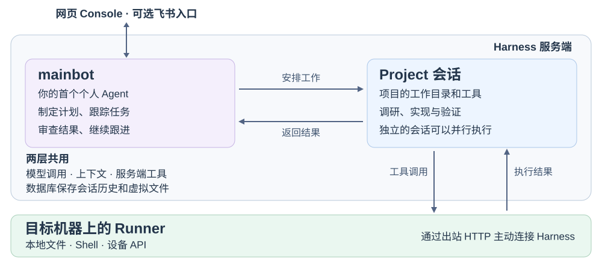
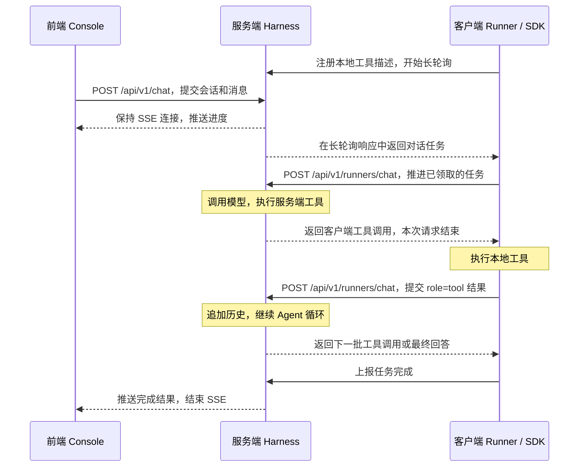

# JAgentHarness

[English](README.md) | **简体中文** · [快速启动（英文）](QUICK_START.md) · [文档导航](docs/README.zh-CN.md)

JAgentHarness 为每位用户提供一个 **mainbot**。它是可以长期对话的个人 Agent，能记住之前的工作，在多次对话之间持续推进同一个目标。你可以在网页或飞书里直接告诉它想完成什么。需要读文件、改代码或运行命令时，mainbot 会创建或复用 Project，检查执行结果，再回到原对话向你汇报。

## 整体架构

| 组成 | 职责 |
| --- | --- |
| **mainbot** | 跨对话保留记忆。遇到复杂目标时，它可以拆解任务、记录依赖、主动检查进度，并根据 Project 返回的结果调整下一步。 |
| **Project** | 为具体工作提供工作目录、工具和会话。mainbot 可以分别开会话做调研、实现和验证。打开 **mainbot → Projects** 就能查看命令和结果。你也可以自己创建 Project，直接在项目里工作。 |
| **Runner** | 部署在文件或设备所在的机器上。Coding Runner 在那里读写文件、执行 Shell 命令，并主动连接 Harness 回传结果。模型调用、会话历史和虚拟文件存储由服务端负责。 |

只要 Harness 和 Runner 持续运行，项目结果或定时检查就能唤醒 mainbot，让它继续跟进。任务需要另一台机器时，它还可以委托其他 Agent。例如，绑定 Linux Runner 的 mainbot 可以请绑定 Mac Runner 的 Agent 执行 Xcode 构建，拿到结果后继续推进原任务。每个 Agent 都通过自己的 Project 开展工作。

## 第一次和 mainbot 对话

1. 在源码仓库或本版本应用 ZIP 的解压目录中，将 `.env.example` 复制为 `.env.local`，填入模型名称和服务地址。[运行环境和模型配置](QUICK_START.md#install-and-start)
2. 运行 `node scripts/start.mjs local`。Node Runner 打开控制台后，进入 **Agents → mainbot → Chat**。
3. 发一个能当场核对结果的请求：

   > 帮我在新工作目录准备一份发布清单。把“运行测试”和“写发布说明”写入 CHECKLIST.md，勾选“运行测试”，再读回文件，告诉我文件路径和剩下的一项。

在 **Chat** 里看文件路径和待办项，在 mainbot 的 **Projects** 里看实际读写过程。然后在原对话里说：“把发布说明也勾上，再检查一次文件。”mainbot 可以回到同一工作目录继续。想看它如何跟进更长的任务，可以接着做[个人 Agent 示例](docs/guides/agents.zh-CN.md)。

Linux 无桌面部署可以使用服务账户安装命令，在其他设备打开网页配对。默认使用 SQLite，同一服务端安装包也可以连接 PostgreSQL。[Linux 安装](QUICK_START.md#linux-servers-and-existing-services) · [数据库配置](QUICK_START.md#choose-a-database)

## 还能怎样使用 mainbot

- **询问或配置 JAgentHarness。** 一键启动会为 mainbot 登记配套源码。你可以让它通过 Project 查代码解释运行原理，也可以让它添加模型、安装 Skill 等。[配置指南](docs/guides/configuration.md#ask-mainbot-to-configure-jagentharness)
- **让文件留在实际工作机器上。** Harness 和网页可部署在远程服务器，笔记本或另一台服务器只运行轻量 Runner。其他浏览器配对后也能进入同一个用户空间。[远程部署与浏览器配对](docs/guides/access.md)
- **换一种交互入口。** 连接飞书即可收发消息和进展，也可以让其他 AI 助手通过接口使用 Agent。[飞书接入](docs/guides/feishu.md) · [外部 Agent 接入](docs/guides/external-agents.md)

直接在 Project 聊天时，Runner 如何执行工具

[服务端库](jagent-harness-sdk/README.md) · [Node.js Runner](sdk/node/README.zh-CN.md) · [HTTP 协议](protocol/README.md) · [开发指南](CONTRIBUTING.md) · [MIT 许可证](LICENSE)
