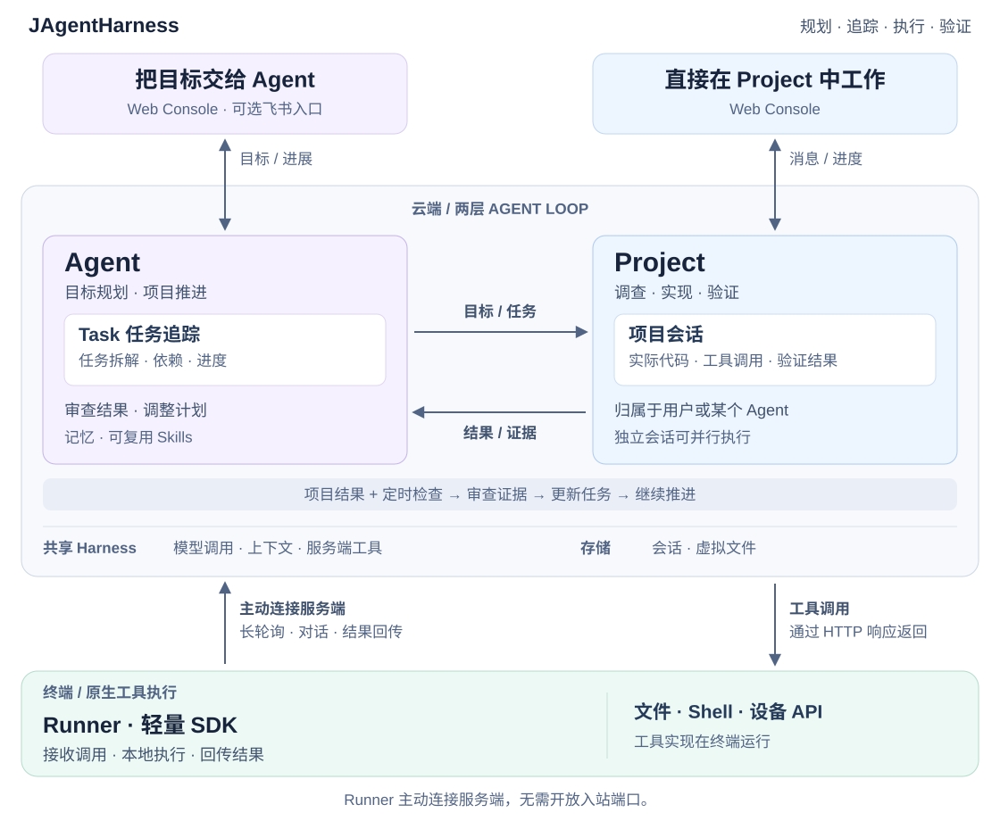
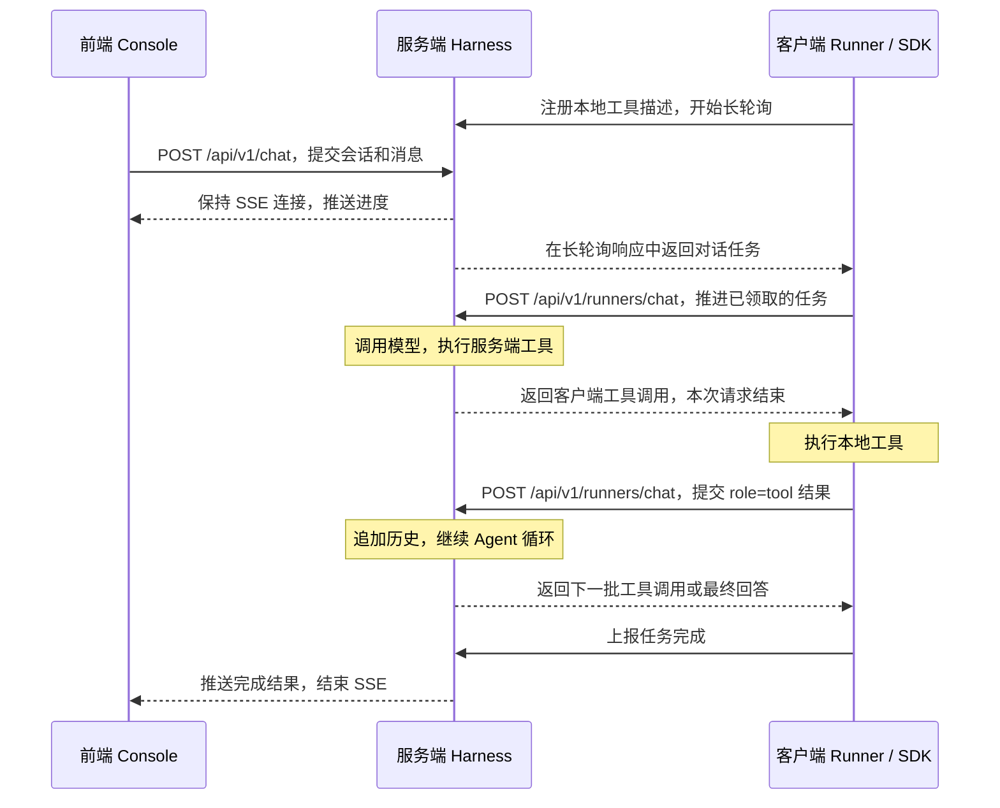

# JAgentHarness

[English](README.md) | **简体中文**

[快速启动](QUICK_START.md) · [文档导航](docs/README.zh-CN.md)

**把目标交给 Agent，让工具在实际工作环境中执行。**

你可以直接在 Project 中工作，也可以把目标交给持续存在的 Agent，由它规划、追踪并推进任务。JAgentHarness 在服务端运行这两层能力，通过轻量 Runner 在文件和应用所在的终端执行原生工具。

## 整体架构



- **Agent 规划与追踪，Project 推进具体工作。** Agent 将目标拆成任务，跟踪依赖和进度，通过 Project 会话调查、实现与验证。项目结果与定时检查促使它审查证据、调整计划。用户也可以直接操作 Project。
- **Agent Loop 在云端，原生工具在终端。** Agent 与 Project 共用服务端 Harness，项目会话通过轻量 Runner 在目标环境执行工具并回传结果，执行环境无需嵌入模型 SDK 或服务端框架。

共享 Harness 提供模型调用、上下文管理和服务端工具，以统一的会话与虚拟文件存储作为支撑。

## 可以做什么

| 能力 | 从这里开始 |
| --- | --- |
| 在项目会话中直接操作文件和工具 | [项目指南](docs/guides/projects.md) |
| 交给 Agent 一个目标，由它规划、追踪任务并验证结果 | [个人 Agent](docs/guides/agents.zh-CN.md) |
| 记住偏好，将已验证的方法沉淀为可复用 Skill | [记忆与学习](docs/guides/knowledge.md) |
| 配置指引、Skills、原生工具和可选的 MCP 工具 | [配置指南](docs/guides/configuration.md) |
| 通过飞书或其他 AI 助手与 Agent 交流 | [飞书](docs/guides/feishu.md) · [外部 Agent 接入](docs/guides/external-agents.md) |

首次使用从 [Quick start](QUICK_START.md) 开始。[文档导航](docs/README.zh-CN.md) 按使用目的列出功能指南、界面入口和集成参考。

## 三个部分，一套协议

| 部分 | 职责 | 当前实现 |
| --- | --- | --- |
| **Agent Harness** | 个人 Agent 与项目会话，共享模型调用、上下文、数据库存储和服务端工具 | Java 库与[服务端示例](examples/server-demo/README.md) |
| **Runner** | 场景原生工具、执行权限及结果回传 | [客户端 SDK](sdk/java/README.md)，并提供开箱即用的 [Coding 发行包](examples/coding-runner/README.zh-CN.md) |
| **交互前端** | 通过服务端接口管理 Agent 与项目对话、任务、知识和配置 | [Web Console](console/README.md)，可部署在服务端或客户端 |

Runner 自带工具，通过主动发起的 HTTP 长轮询连接服务端，无需开放入站端口。新场景通过实现 `ToolDefinition` 扩展工具。前端无论部署在哪里，都使用服务端 API。仅使用服务端工具的项目无需 Runner。

<details>
<summary>Runner 对话执行流程</summary>

绑定 Runner 的会话通过长轮询派发整次对话任务。后续工具调用与结果通过同一会话中的普通对话请求往返，前端持续接收一条连贯的事件流。



工具调用与结果回传可以重复多轮。执行本地工具期间，Runner 继续长轮询以接收取消指令。自定义前端使用同一套公开服务端接口，本地工具统一由项目绑定的 Runner 执行。

</details>

## 快速体验

安装 **JDK 8+**、**Maven 3.6.3+** 和 **Node.js 22.12+**，准备一个兼容 OpenAI 的模型接口。示例自带 SQLite，无需安装数据库服务。

```sh
git clone https://github.com/differentialmanifold/jagent-harness.git
cd jagent-harness
cp .env.example .env.local
```

在 `.env.local` 中配置模型：

```dotenv
JAGENT_MODEL=your-model-name
JAGENT_OPENAI_BASE_URL=https://your-provider.example/v1
JAGENT_OPENAI_API_KEY=your-api-key
```

启动三个部分：

```sh
node scripts/dev.mjs
```

打开 **http://127.0.0.1:5175**，选择一种方式开始：

- **让 Agent 自主推进：** 打开 **Agents → New Agent**，填写名称并选择 **coding-local**。在 Chat 中提出目标，它可以自行创建项目和工作目录。[简短的 Agent 示例](docs/guides/agents.zh-CN.md) 提供可直接发送的要求和观察指引。
- **操作自己的项目：** 添加项目，选择 **coding-local**，浏览或输入该终端上的工作目录，然后发送：

> 阅读工作区中的 README，总结这个项目。

服务端推进对话，Runner 在目标机器读取文件。新项目默认启用全部七个 coding 工具；在 **Projects → Configuration → Tools → Client tools** 中修改项目工具选择，已选工具以 **Full access** 模式执行，不弹出审批。一个 Runner 可以服务多个不同目录的项目。按 **Ctrl+C** 停止示例。

独立启动、手动命令、远程终端和 Windows/macOS 快捷方式见 [Quick start](QUICK_START.md)（英文）。

## 文档与开发

- [文档导航](docs/README.zh-CN.md)：查找功能指南、界面入口和集成参考；尚无中文版本的指南标为英文。
- [服务端集成](jagent-harness-sdk/README.md)、[Java 客户端 SDK](sdk/java/README.md)、[Console 部署](console/README.md)、[HTTP/JSON 协议](protocol/README.md)：按需部署与扩展。
- [开发指南](CONTRIBUTING.md)：源码结构、验证命令，以及新增功能时文档应该放在哪里。

本源码树的目标版本为 `2.2.1`。使用本地修改构建独立 Maven 项目前，请先运行 `mvn install`。当前服务端支持单实例部署和应用级身份验证，终端权限由 Runner 控制。

[MIT License](LICENSE)。
